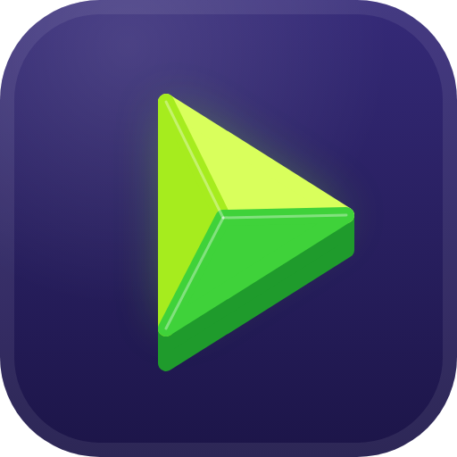
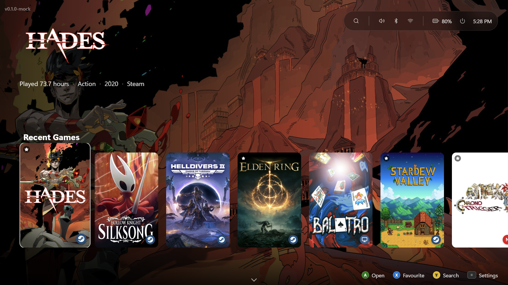
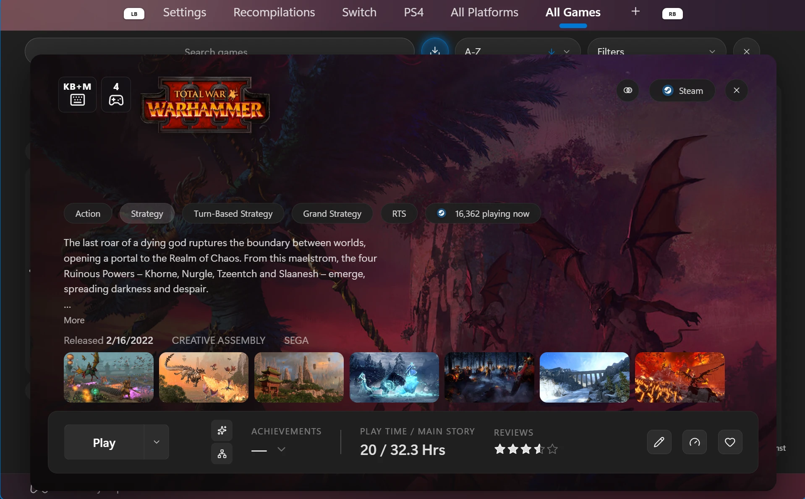
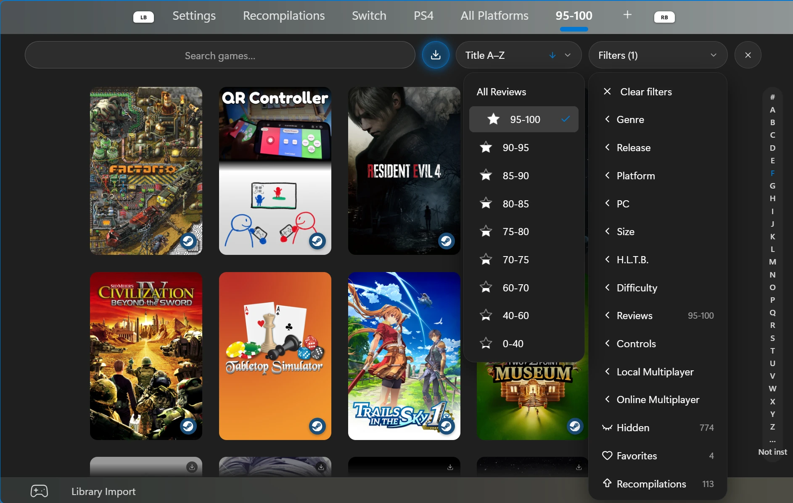
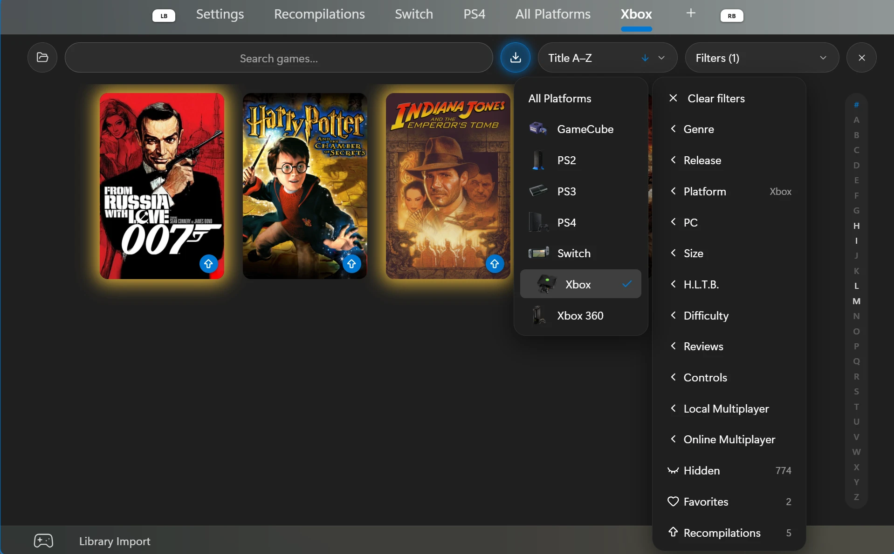

<p align="center"></p>

# PlayOut

PlayOut is a console-style game launcher for Windows 11. It finds the games you already have installed
through Steam, Epic Games, GOG, EA App, Battle.net, Ubisoft Connect and the Xbox / Microsoft Store, adds the
ROMs you keep in an ES-DE-style folder tree and any executable you point it at, fetches artwork and metadata,
and shows all of it in a full-screen, Xbox-dashboard-like UI that you drive with a mouse, a keyboard, a
gamepad or touch.

In one line: ES-DE's ROM-folder model + Playnite's installed-game detection, wrapped in a "Winhanced"
dashboard. PlayOut never signs in to a store; version 1 works from local install data only.

## Screenshots

| Home                                      | Game detail                                       |
| ----------------------------------------- | ------------------------------------------------- |
|  |  |

| Library: Filters › Reviews                                      | Library: Filters › Platform                                       |
| --------------------------------------------------------------- | ----------------------------------------------------------------- |
|  |  |

The game detail and library pictures are from PlayOut running on a real library; the home screen is produced by
`npm run screenshot` (see [Development](#development)).

## Features

- **Store games, no sign-in.** Installed games are read from each client's own install data: Steam
  (`appmanifest_*.acf`), Epic Games Launcher, GOG Galaxy, EA App, Battle.net, Ubisoft Connect and Microsoft
  Store packages. Games launch through the client (`steam://`, `com.epicgames.launcher://`, `uplay://`, ...)
  so cloud saves, overlays and DRM keep working.
- **ROM folders like ES-DE.** One subfolder per system (`nes`, `snes`, `psx`, ...), 190+ systems, nested
  folders, `.m3u` multi-disc playlists and "directory as game" layouts. Titles are cleaned of `(USA)` and
  `[!]` tags.
- **Emulators found automatically.** ES-DE's Windows find rules locate RetroArch (and its cores) and the
  standalone emulators; every path can be overridden in Settings, and each system or game can use an
  alternative emulator.
- **Manual games.** Add a single `.exe`, or scan a folder and let PlayOut pick out the games.
- **Saves that follow you.** ROM and recompilation saves are kept in the Emulation folder automatically, which
  PlayOut syncs between your PCs and which can sit in any folder your cloud app syncs (OneDrive, Google Drive...);
  store games keep their own cloud saves, because they launch through their client.
- **Emulators set up for you.** One-click, pre-configured setup of popular emulators: full screen, controllers
  mapped, Big Picture modes and a Start + Select menu.
- **Nucleus Co-op built in.** Split-screen local co-op for PC games that never had it, set up and started from the
  game's page.
- **Built-in PC tools.** DLSS swapping (DLSS 5 through AiO Swapper), OptiScaler, and game compression to save disk
  space, from each game's Upgrade menu.
- **Recompilations.** Browse and download the latest native PC recompilations of console games, with their updates.
- **Artwork and metadata.** Covers, hero art, logos, icons, descriptions, release dates, genres and ratings
  from SteamGridDB, IGDB, ScreenScraper, TheGamesDB, the Steam store and GOG; HowLongToBeat times; local art
  from Steam's own cache; import of an existing ES-DE library (`gamelist.xml` + `downloaded_media`).
- **Play tracking.** Sessions, total play time, last played and play count, with Steam's own play time
  imported; Steam achievements and "N playing now".
- **Console UI.** Hero backdrop, Recent row, one row per platform, detail panel with a Play split button,
  search overlay with an on-screen keyboard, settings, quick panel. The UI scales with the screen (1 rem =
  1/108 of the height) so it looks the same on a 1280x800 handheld and a 4K TV.
- **System bar and quick panel.** Battery, Wi-Fi, Bluetooth, volume and clock; power mode, brightness,
  volume, CPU/RAM; sleep, restart, shut down; shortcuts into Windows settings.
- **Every input method.** Mouse, keyboard, any standard-mapping gamepad (Xbox / XInput controllers work out
  of the box, with rumble) and touch, all through one focus engine.
- **Stays out of the way.** The window minimizes while a game runs and comes back when the game ends.
- **Light footprint.** No native modules, no database server: three JSON files and an image cache in
  `%APPDATA%\PlayOut`.

## Requirements

- Windows 11, 64-bit. (Windows 10 22H2 is not tested. System status and controls use Windows PowerShell 5.1,
  which ships with Windows.)
- For store games: the store's own client must be installed; PlayOut launches games through it.
- **Emulators are not bundled.** Install RetroArch and/or the standalone emulators you want, plus any BIOS
  files they require, then let PlayOut find them (see [Emulators](#emulators)).
- A gamepad with a standard mapping (Xbox controllers over USB or Bluetooth are the reference). Optional.
- Internet access for artwork and metadata. Optional; the launcher works offline.

## Install

Build artifacts land in `dist/` (see [Development](#development)); releases ship the same two files:

| File                             | What it is                                                                            |
| -------------------------------- | ------------------------------------------------------------------------------------- |
| `PlayOut-<version>-setup.exe`    | NSIS installer: per-user install, Start-menu and desktop shortcut, choose the folder. |
| `PlayOut-<version>-portable.exe` | Single executable, nothing to install; keep it in its own folder.                     |

PlayOut stores its data in `%APPDATA%\PlayOut`: `library.json`, `settings.json`, `sessions.json`, the
`media\` image cache and `logs\main.log`. Uninstalling leaves that folder in place so the library survives
reinstalls; delete it to start over.

The Emulation folder (saves, BIOS files, ROMs and a copy of your favourites list) is `Documents\Emulation` on a new
install and can never be inside PlayOut's install or data folder, so uninstalling never deletes it. Choosing another
place in Settings → Library moves it there; favourites come back from it after a reinstall.

Settings → About → **Check for Updates** looks for a newer release on
[jeremybris/PlayOut](https://github.com/jeremybris/PlayOut/releases). The installed version
downloads it with a progress bar and restarts to install; the portable exe opens the release page instead.

## Quick start

1. Start PlayOut. It opens full screen; `F11` toggles between full screen and a window.
2. With an empty library the Recent row shows a dashed **Add Games** tile and it is already focused. Press
   `Enter` / **A** (or click / tap it). The same tile sits at the end of the Recent row later on, and
   **Settings → Library** reaches the same dialog.
3. In **Add Games**:
   - **Stores**: every detected client has a **Scan** button; the card shows "not installed" when the client
     is missing. Scan the ones you use.
   - **Choose ROM folder**: pick the root folder that holds one subfolder per system (layout below). PlayOut
     scans it and lists the systems it found and the subfolders it did not recognise.
   - **Add a game (.exe)** adds one executable; **Scan a folder for games** walks a folder and adds the
     executables that look like games.
4. Rows appear per platform; focus a card and press **A** / `Enter` to open its detail panel, then **Play**.
5. Open **Settings → Metadata** and paste the API keys for the art sources you want (see
   [Metadata and artwork keys](#metadata-and-artwork-keys)); artwork is fetched in the background.
6. Check **Settings → Emulators**: each emulator shows the path PlayOut resolved or "not found" with a
   **Browse** button.

The full walkthrough, including every setting and a troubleshooting section, is in
[docs/USER-GUIDE.md](docs/USER-GUIDE.md).

## ROM folder layout

Point PlayOut at one root folder (for example `D:\ROMs`). Inside it, every system has its own subfolder named
like ES-DE names it; files may be nested further in any way you like:

```
D:\ROMs\
  nes\Super Mario Bros. 3 (USA).zip
  snes\Chrono Trigger (USA).sfc
  psx\Final Fantasy VII (USA)\Final Fantasy VII (USA).m3u     <- the .m3u is the game, the discs are hidden
  psx\Final Fantasy VII (USA)\Final Fantasy VII (USA) (Disc 1).chd
  ps3\Demon's Souls.ps3\...                                   <- a folder named <game>.ps3 is one game
  scummvm\Day of the Tentacle.scummvm
```

Rules: file extensions are matched case-insensitively against the system's list; folders whose name ends
in a listed extension (`.ps3`, `.scummvm`, `.m3u`, ...) count as one game; `.m3u` playlists are the game and
the discs they reference are hidden; hidden files, `noload.txt` folders and system files are skipped;
`(USA)`, `[!]` and similar tags are moved out of the title. Subfolders that match no system are reported
after the scan.

The 30 most common systems (from the ES-DE system list; the full list of 190+ is in
`resources/systems/systems.json`):

| Folder                          | System                        | Extensions                                                                                                                                                                                                                    | Default emulator                | BIOS                |
| ------------------------------- | ----------------------------- | ----------------------------------------------------------------------------------------------------------------------------------------------------------------------------------------------------------------------------- | ------------------------------- | ------------------- |
| `nes`                           | Nintendo Entertainment System | `.3dsen` `.fds` `.nes` `.unf` `.unif` `.7z` `.zip`                                                                                                                                                                            | Mesen (RetroArch)               | No                  |
| `snes`                          | Super Nintendo                | `.bin` `.bml` `.bs` `.bsx` `.dx2` `.fig` `.gd3` `.gd7` `.mgd` `.sfc` `.smc` `.st` `.swc` `.7z` `.zip`                                                                                                                         | Snes9x - Current (RetroArch)    | No                  |
| `gb`                            | Game Boy                      | `.bs` `.cgb` `.dmg` `.gb` `.gbc` `.gbx` `.sgb` `.sfc` `.smc` `.7z` `.zip`                                                                                                                                                     | Gambatte (RetroArch)            | No                  |
| `gbc`                           | Game Boy Color                | `.bs` `.cgb` `.dmg` `.gb` `.gbc` `.gbx` `.sgb` `.sfc` `.smc` `.7z` `.zip`                                                                                                                                                     | Gambatte (RetroArch)            | No                  |
| `gba`                           | Game Boy Advance              | `.agb` `.bin` `.cgb` `.dmg` `.gb` `.gba` `.gbc` `.gbx` `.sgb` `.7z` `.zip`                                                                                                                                                    | mGBA (RetroArch)                | Only for ares       |
| `nds`                           | Nintendo DS                   | `.app` `.bin` `.dsi` `.ids` `.nds` `.7z` `.zip`                                                                                                                                                                               | melonDS DS (RetroArch)          | No                  |
| `n3ds`                          | Nintendo 3DS                  | `.3ds` `.3dsx` `.app` `.axf` `.cci` `.cxi` `.elf` `.lnk` `.z3dsx` `.zcci` `.zcxi` `.7z` `.zip`                                                                                                                                | Azahar (RetroArch)              | No                  |
| `n64`                           | Nintendo 64                   | `.bin` `.d64` `.exe` `.lnk` `.n64` `.ndd` `.u1` `.v64` `.z64` `.7z` `.zip`                                                                                                                                                    | Mupen64Plus-Next (RetroArch)    | No                  |
| `gc`                            | GameCube                      | `.ciso` `.dff` `.dol` `.elf` `.gcm` `.gcz` `.iso` `.json` `.m3u` `.rvz` `.tgc` `.wad` `.wbfs` `.wia` `.7z` `.zip`                                                                                                             | Dolphin (RetroArch)             | No                  |
| `wii`                           | Wii                           | `.ciso` `.dff` `.dol` `.elf` `.gcm` `.gcz` `.iso` `.json` `.m3u` `.rvz` `.tgc` `.wad` `.wbfs` `.wia` `.7z` `.zip`                                                                                                             | Dolphin (RetroArch)             | No                  |
| `wiiu`                          | Wii U                         | `.elf` `.rpx` `.tmd` `.wua` `.wud` `.wuhb` `.wux`                                                                                                                                                                             | Cemu (standalone)               | No                  |
| `switch`                        | Nintendo Switch               | `.lnk` `.nca` `.nro` `.nso` `.nsp` `.xci`                                                                                                                                                                                     | Eden (standalone)               | Yes                 |
| `psx`                           | PlayStation                   | `.bin` `.cbn` `.ccd` `.chd` `.cue` `.ecm` `.exe` `.img` `.iso` `.m3u` `.mdf` `.mds` `.minipsf` `.pbp` `.psexe` `.psf` `.toc` `.z` `.znx` `.7z` `.zip`                                                                         | Beetle PSX (RetroArch)          | Yes                 |
| `ps2`                           | PlayStation 2                 | `.bin` `.chd` `.ciso` `.cso` `.dump` `.elf` `.gz` `.lnk` `.m3u` `.mdf` `.img` `.iso` `.isz` `.ngr` `.nrg` `.zso`                                                                                                              | PCEE2 (RetroArch)               | Yes (not for Play!) |
| `ps3`                           | PlayStation 3                 | `.iso` `.lnk` `.ps3` `.ps3dir`                                                                                                                                                                                                | RPCS3 (standalone)              | Yes                 |
| `psp`                           | PlayStation Portable          | `.chd` `.cso` `.elf` `.iso` `.pbp` `.prx` `.7z` `.zip`                                                                                                                                                                        | PPSSPP (RetroArch)              | No                  |
| `psvita`                        | PlayStation Vita              | `.psvita`                                                                                                                                                                                                                     | Vita3K (standalone)             | Yes                 |
| `mastersystem`                  | Sega Master System            | `.68k` `.bin` `.bms` `.chd` `.col` `.cue` `.gen` `.gg` `.iso` `.m3u` `.md` `.mdx` `.rom` `.sg` `.sgd` `.smd` `.sms` `.7z` `.zip`                                                                                              | Genesis Plus GX (RetroArch)     | No                  |
| `genesis` (also `megadrive`)    | Sega Genesis / Mega Drive     | `.32x` `.68k` `.bin` `.bms` `.chd` `.cue` `.gen` `.gg` `.iso` `.m3u` `.md` `.mdx` `.sg` `.sgd` `.smd` `.sms` `.7z` `.zip`                                                                                                     | Genesis Plus GX (RetroArch)     | No                  |
| `segacd`                        | Sega CD                       | `.68k` `.bin` `.bms` `.chd` `.cue` `.gen` `.gg` `.iso` `.m3u` `.md` `.mdx` `.sg` `.sgd` `.smd` `.sms` `.7z` `.zip`                                                                                                            | Genesis Plus GX (RetroArch)     | Yes                 |
| `saturn`                        | Sega Saturn                   | `.bin` `.ccd` `.chd` `.cue` `.iso` `.m3u` `.mds` `.toc` `.7z` `.zip`                                                                                                                                                          | Beetle Saturn (RetroArch)       | Yes                 |
| `dreamcast`                     | Sega Dreamcast                | `.cdi` `.chd` `.cue` `.dat` `.elf` `.gdi` `.iso` `.lst` `.m3u` `.7z` `.zip`                                                                                                                                                   | Flycast (RetroArch)             | No                  |
| `pcengine` (also `tg16`)        | PC Engine / TurboGrafx-16     | `.ccd` `.chd` `.cue` `.img` `.iso` `.m3u` `.pce` `.rom` `.sgx` `.toc` `.7z` `.zip`                                                                                                                                            | Beetle PCE (RetroArch)          | No                  |
| `neogeo`                        | Neo Geo                       | `.neo` `.7z` `.zip`                                                                                                                                                                                                           | FinalBurn Neo (RetroArch)       | Yes                 |
| `arcade` (also `mame`, `fbneo`) | Arcade                        | `.acgame` `.arcadedef` `.bat` `.cmd` `.gam` `.lindbergh` `.lnk` `.neo` `.7z` `.zip`                                                                                                                                           | MAME - Current (RetroArch)      | Depends on the game |
| `atari2600`                     | Atari 2600                    | `.a26` `.bin` `.7z` `.zip`                                                                                                                                                                                                    | Stella (RetroArch)              | No                  |
| `c64`                           | Commodore 64                  | `.bin` `.cmd` `.crt` `.d2m` `.d4m` `.d64` `.d6z` `.d71` `.d7z` `.d80` `.d81` `.d82` `.d8z` `.g41` `.g4z` `.g64` `.g6z` `.gz` `.lnx` `.m3u` `.nbz` `.nib` `.p00` `.prg` `.t64` `.tap` `.vfl` `.vsf` `.x64` `.x6z` `.7z` `.zip` | VICE x64sc Accurate (RetroArch) | No                  |
| `amiga`                         | Commodore Amiga               | `.adf` `.adz` `.ccd` `.chd` `.cue` `.dms` `.fdi` `.hdf` `.hdz` `.ipf` `.iso` `.lha` `.m3u` `.mds` `.nrg` `.rp9` `.uae` `.7z` `.zip`                                                                                           | PUAE (RetroArch)                | Yes                 |
| `dos`                           | DOS                           | `.bat` `.com` `.conf` `.cue` `.dosz` `.exe` `.img` `.iso` `.7z` `.zip`                                                                                                                                                        | DOSBox-Pure (RetroArch)         | No                  |
| `scummvm`                       | ScummVM                       | `.scummvm` `.svm`                                                                                                                                                                                                             | ScummVM (RetroArch)             | No                  |

BIOS files are the emulator's business: place them where the emulator expects them (RetroArch:
`<RetroArch>\system\`). PlayOut does not check for them.

## Emulators

PlayOut resolves the emulator for a system at launch time from the ES-DE find rules shipped in
`resources/systems/find-rules.json`, in this order:

1. The path you set in **Settings → Emulators** (Browse to the executable). This always wins.
2. The Windows _App Paths_ registry key of the executable (set by installers such as RetroArch's).
3. The executable on your `PATH`.
4. Well-known install locations. For RetroArch: `C:\RetroArch-Win64\`, `C:\RetroArch\`,
   `%APPDATA%\RetroArch\`, `C:\Program Files\RetroArch-Win64\`, `C:\Program Files\RetroArch\`, the
   `Program Files (x86)` variants and the Steam copy (`steamapps\common\RetroArch\`).
5. PlayOut's own emulator folders: `Emulators\<name>\` next to `PlayOut.exe` (handy for the portable
   build) and `%APPDATA%\PlayOut\Emulators\<name>\`. The folder and executable names follow ES-DE, for
   example:

| Emulator       | Expected location inside `Emulators\`                        |
| -------------- | ------------------------------------------------------------ |
| RetroArch      | `RetroArch-Win64\retroarch.exe` or `RetroArch\retroarch.exe` |
| Dolphin        | `Dolphin-x64\Dolphin.exe`                                    |
| PCSX2          | `PCSX2-Qt\pcsx2-qt*.exe`                                     |
| DuckStation    | `duckstation\duckstation-qt-x64-ReleaseLTCG.exe`             |
| PPSSPP         | `PPSSPP\PPSSPPWindows64.exe`                                 |
| Cemu           | `cemu\Cemu.exe`                                              |
| Ryujinx        | `ryujinx\Ryujinx.exe`                                        |
| RPCS3          | `RPCS3\rpcs3.exe`                                            |
| xemu           | `xemu\xemu.exe`                                              |
| xenia          | `xenia\xenia.exe` or `xenia_canary\xenia_canary.exe`         |
| MAME           | `mame\mame.exe`                                              |
| Flycast        | `flycast\flycast.exe`                                        |
| mGBA           | `mGBA\mGBA.exe`                                              |
| melonDS        | `melonDS\melonDS.exe`                                        |
| Azahar         | `azahar\azahar.exe`                                          |
| Snes9x         | `snes9x\snes9x-x64.exe`                                      |
| Mesen          | `Mesen\Mesen.exe`                                            |
| DOSBox Staging | `dosbox-staging\dosbox.exe`                                  |
| ScummVM        | `scummvm\scummvm.exe`                                        |

**RetroArch cores.** Most systems default to a RetroArch core, loaded from `<RetroArch>\cores\<core>_libretro.dll`
(for example `snes9x_libretro.dll`, `mesen_libretro.dll`, `mednafen_psx_libretro.dll`,
`genesis_plus_gx_libretro.dll`, `mupen64plus_next_libretro.dll`, `dolphin_libretro.dll`,
`flycast_libretro.dll`, `ppsspp_libretro.dll`, `mame_libretro.dll`, `fbneo_libretro.dll`,
`dosbox_pure_libretro.dll`, `scummvm_libretro.dll`). Install cores from RetroArch's **Online Updater → Core
Downloader**. If your cores live elsewhere, set **Settings → Emulators → Cores directory**. A missing core
produces a "core missing" launch error that names the file.

**Alternatives.** Every system lists its alternative emulators (RetroArch cores and standalone emulators such
as DuckStation, PCSX2, Dolphin, PPSSPP). Pick one per system in **Settings → Emulators** or per game from the
**Play ▾** menu / the game's gear button. When an emulator cannot be found, the launch error dialog shows the
paths that were searched and offers the emulator's download page and a shortcut to Settings → Emulators.

## Metadata and artwork keys

All sources are optional. Without any key PlayOut still gets Steam art and store data (keyless), GOG data,
HowLongToBeat times and whatever your Steam client and ES-DE installation already have on disk.

| Source           | Used for                                                                                                | Credential                                      | Where to get it                                                                                                                                                                                                                                                                                                                                                                        |
| ---------------- | ------------------------------------------------------------------------------------------------------- | ----------------------------------------------- | -------------------------------------------------------------------------------------------------------------------------------------------------------------------------------------------------------------------------------------------------------------------------------------------------------------------------------------------------------------------------------------- |
| SteamGridDB      | Covers (600x900), hero art, logos, icons for every platform                                             | API key                                         | Sign in at [steamgriddb.com](https://www.steamgriddb.com/) (Steam login) → Profile → **Preferences → API** → Generate.                                                                                                                                                                                                                                                                 |
| IGDB (Twitch)    | Descriptions, release dates, developers, publishers, genres, ratings, covers, screenshots, time to beat | Client ID + Client Secret                       | Twitch account with two-factor auth → [dev.twitch.tv/console/apps](https://dev.twitch.tv/console/apps) → **Register Your Application** (any name, redirect URL `http://localhost`, category _Application Integration_) → copy the Client ID and generate a Client Secret. PlayOut requests the access token itself. Free for non-commercial use.                                       |
| ScreenScraper    | ROM metadata and art matched by file hash (boxes, wheels/logos, screenshots, fan art, videos)           | Developer id + password, plus your user account | Create a user account at [screenscraper.fr](https://www.screenscraper.fr/). Developer credentials are issued per application on the ScreenScraper forum; PlayOut does not ship its own yet, so enter your own developer id/password together with your user name/password, or leave the fields empty to skip ScreenScraper.                                                            |
| TheGamesDB       | Box art, fan art, clear logos, screenshots, overviews for console games                                 | API key                                         | Register / log in at [thegamesdb.net](https://thegamesdb.net/), then open [api.thegamesdb.net/key.php](https://api.thegamesdb.net/key.php). Public keys have a monthly request allowance.                                                                                                                                                                                              |
| Steam Web API    | Your achievements (unlocked / total, list) for Steam games                                              | Web API key + SteamID64                         | Key: [steamcommunity.com/dev/apikey](https://steamcommunity.com/dev/apikey) (needs a non-limited account; any domain label works). SteamID64: the 17-digit number in your profile URL (`steamcommunity.com/profiles/7656119...`), or **Steam → Settings → Account**. Your profile's _Game details_ must be public for achievements to load. Play time and "N playing now" need no key. |
| HowLongToBeat    | Main story / Main + extras / Completionist hours                                                        | none (toggle)                                   | **Settings → Metadata → HowLongToBeat**.                                                                                                                                                                                                                                                                                                                                               |
| Steam store, GOG | Store descriptions and art for Steam / GOG games                                                        | none                                            | Automatic.                                                                                                                                                                                                                                                                                                                                                                             |

Keys live in `settings.json` and are only sent to the service they belong to. **Settings → Metadata** also
sets the art-source priority, auto-scrape after scans, the preferred region (`us`, `eu`, `jp`, `wor`) and
**Refresh all**.

## Controls

One focus engine serves every input method: hovering with the mouse focuses, clicking activates; touch
taps focus and activate; rows scroll with the wheel, by dragging or by swiping. Button hints are shown at the
bottom of every screen.

**Keyboard**

| Key             | Action                                     |
| --------------- | ------------------------------------------ |
| Arrow keys      | Move focus                                 |
| Enter           | Activate (open the game, press the button) |
| Esc / Backspace | Back / close                               |
| F               | Favourite the focused game                 |
| Tab             | Cycle sections                             |
| /               | Search                                     |
| F11             | Toggle full screen                         |
| Alt+F4          | Quit PlayOut                               |

**Gamepad** (standard mapping, Xbox button names)

| Control            | Action                                                     |
| ------------------ | ---------------------------------------------------------- |
| D-pad / left stick | Move focus (hold to repeat)                                |
| A                  | Activate                                                   |
| B                  | Back                                                       |
| X                  | Screen-specific secondary action (detail panel: Play menu) |
| Y                  | Search                                                     |
| LB / RB            | Previous / next row (Home) or section (Settings)           |
| Menu (Start)       | Settings                                                   |
| View (Back)        | Quick panel (power, performance)                           |
| Right stick        | Scroll descriptions and lists                              |

**Settings → Controls** has the stick deadzone, vibration on/off, A/B swap for Nintendo-layout controllers and
the key-repeat timing.

**Touch and mouse**

| Gesture            | Action                                                             |
| ------------------ | ------------------------------------------------------------------ |
| Tap / click        | Focus and activate                                                 |
| Swipe / drag a row | Scroll the row                                                     |
| Mouse wheel        | Scroll rows and lists                                              |
| Hover              | Focus (no activation)                                              |
| Text fields        | On-screen keyboard in Search; the Windows touch keyboard elsewhere |

## Development

```bash
npm install            # also downloads Electron (postinstall)
npm run dev            # Electron + Vite with hot reload
npm run dev:web        # renderer only, in the browser with the mock API: http://localhost:5174
npm run test           # vitest unit tests, then node --test scripts/*.test.mjs (packaging)
npm run typecheck      # tsc for main/preload (tsconfig.node.json) and renderer (tsconfig.web.json)
npm run lint           # eslint
npm run i18n:check     # translation coverage per language (docs/TRANSLATING.md)
npm run screenshot     # builds, then captures docs/screenshots/<screen>.png with the mock API
npm run build:win      # NSIS installer + portable exe in dist/
npm run build:unpack   # unpacked app in dist/win-unpacked for a quick look
npm run release:win    # the same build, published as a GitHub release (needs GH_TOKEN, see below)
npm run make-icon      # regenerates build/icon.png, build/icon.ico, resources/icon.png
node scripts/build-xbox-helper.mjs   # rebuilds resources/xbox from xbox-helper/ (needs the .NET 10 SDK)
```

The Xbox / Xbox 360 image conversions run in a small helper, `resources/xbox/PlayOutXbox.exe`, built from the C#
project in `xbox-helper/` on the MIT libraries [XISOSharp](https://github.com/purelogiccode/XISOSharp) and
[CHDSharp](https://github.com/purelogiccode/CHDSharp) (the engine of XISO Studio). Its build is kept in the
repository, so `npm run build` needs no .NET; after changing the helper, run `node scripts/build-xbox-helper.mjs`
with the .NET 10 SDK on PATH (or `DOTNET_EXE=<path to dotnet.exe>`). It publishes one self-contained, trimmed
win-x64 exe, puts CHDSharp's LGPL FLAC codec (`VendoredFlac.dll`, unmodified) beside it and writes
`LICENSES.txt`. The commands and their JSON output are described in `xbox-helper/README.md`. Settings › Convert
runs every Xbox / Xbox 360 direction through it (`builtIn: 'xbox'` in `src/shared/convert.ts`,
`src/main/convert/xbox-helper.ts`), and Trim Games asks its `info` whether an image is already trimmed. Streaming
uses its `read` command (any CHD, 1.3.0+) to find a CHD game's serial for its texture packs
(`src/main/emulation/disc-id.ts`, tested on the synthetic CHDs in `src/main/emulation/fixtures`). Its tests
(`src/main/convert/convert-service.xbox.test.ts`) use a fake helper process, plus one run of the real exe on a
synthetic image it packs itself (skipped when the exe is missing).

`npm run screenshot -- home detail` limits the capture to the named screens (`home`, `detail`, `addgames`,
`settings`, `search`, `empty`, `quickpanel`); add `--no-build` to reuse the last build. Command-line flags of
the app itself: `--windowed` (ignore the full-screen setting), `--mock` (use the in-memory mock API with
sample games and an isolated userData folder in %TEMP%playout-mock), `--screen=<name>` (initial screen in mock mode), `--screenshot=<file.png>` (capture at
1920x1080 and quit), `--scan=<report.json>` (scan every enabled source, write the per-source counts and errors
as JSON, quit). Electron's `--user-data-dir=<folder>` redirects settings, library, media cache and logs, so a
smoke test never touches your real library:

```bash
npx electron . --windowed --user-data-dir=%TEMP%\playout-check --scan=%TEMP%\playout-scan.json
```

To publish an update:

1. Once only: give `jeremybris/PlayOut` an initial commit, because it is empty. Keep the repository public: the
   app reads releases without a token.
2. Raise `version` in `package.json`, and set `GH_TOKEN` to a token that can write releases on that repository.
3. Create the draft first with `gh release create v<version> --repo jeremybris/PlayOut --draft --title <version>`:
   without one, the parallel uploads can each create their own draft and split the files between them.
4. Run `npm run release:win`. It uploads the installer, the portable exe, `latest.yml` and the blockmap to a
   draft release, which no copy of PlayOut can see yet.
5. Check the draft, then publish it. Copies of PlayOut find the update from that moment on.

```bash
gh release edit v<version> --repo jeremybris/PlayOut --draft=false
```

The renderer runs in a plain browser with the mock API so the UI can be developed and screenshot-tested
without Electron; `?mock=1` forces the mock inside Electron as well.

### Project layout

```
src/shared/          types.ts (domain model), api.ts (PlayOutApi + IPC channels), defaults.ts, platforms.ts
src/main/            Electron main process
  index.ts, window.ts, media-protocol.ts, logger.ts, events.ts
  ipc/               handlers.ts (zod-validated PlayOutApi implementation), register.ts
  store/             json-store.ts (atomic, debounced), library-store.ts, settings-store.ts, sessions-store.ts
  services/          library-service.ts (merges scans into the library), scan-service.ts
  providers/         steam, epic, gog, ea, battlenet, ubisoft, xbox, manual, rom
  emulation/         systems, find rules, ROM scanner, launch commands, ES-DE import
  launcher/          launcher, process monitor, session tracker
  scrapers/          steamgriddb, igdb, screenscraper, thegamesdb, steam-store, gog-api, hltb, metadata-service, image-cache
  system/            powershell.ts, registry.ts, status, volume, brightness, power, network, bluetooth, perf
  util/              vdf, hash, fs, paths, text, ids, object
src/preload/         window.playout bridge generated from API_METHODS
src/renderer/src/    React UI: api/ (client + mock), state/ (zustand), input/, styles/, components/, screens/
resources/systems/   systems.json, find-rules.json, platform-ids.json, battlenet-products.json
resources/icon.png   app icon; build/icon.ico + build/icon.png feed electron-builder
resources/xbox/      PlayOutXbox.exe (Xbox image helper), VendoredFlac.dll, LICENSES.txt (from xbox-helper/)
xbox-helper/         C# source of the Xbox image helper (not packaged)
scripts/             screenshot.mjs, make-icon.mjs, build-systems.mjs, build-xbox-helper.mjs, packaging.test.mjs
docs/                ARCHITECTURE.md, USER-GUIDE.md, LICENSES.md, research/ (verified integration notes)
```

[docs/ARCHITECTURE.md](docs/ARCHITECTURE.md) is the module contract: interfaces, flows, the input model and
the design tokens. Code style: TypeScript strict, 2-space indent, single quotes, no semicolons (prettier),
named exports, no native Node modules.

**Translations.** Every user-facing string lives in `src/shared/i18n/locales/<language>/<area>.json`, English
first; a new language is a copied folder, no code change. [docs/TRANSLATING.md](docs/TRANSLATING.md) explains how to
add or fix one, and [src/shared/i18n/EXTRACTION.md](src/shared/i18n/EXTRACTION.md) how code uses the strings.

## Credits and licences

PlayOut is released under the MIT licence (Copyright (c) 2026 Jeremy Bristol).

- The system definitions and emulator find rules (`resources/systems/*.json`) are derived from
  [ES-DE (EmulationStation Desktop Edition)](https://gitlab.com/es-de/emulationstation-de), MIT licence,
  Copyright (c) 2024-2026 Northwestern Software AB, Copyright (c) 2020-2024 Leon Styhre, Copyright (c) 2014
  Alec Lofquist.
- The store detection logic and the Battle.net product table follow
  [Playnite](https://github.com/JosefNemec/Playnite) and its extensions, MIT licence, Copyright (c) 2020
  Josef Nemec.
- Artwork and metadata come from [SteamGridDB](https://www.steamgriddb.com/) (art by its contributors),
  [IGDB.com](https://www.igdb.com/), [ScreenScraper.fr](https://www.screenscraper.fr/),
  [TheGamesDB.net](https://thegamesdb.net/), [HowLongToBeat.com](https://howlongtobeat.com/), Steam and
  GOG, each under its own terms and with your own credentials where required. Game artwork remains the
  property of its publishers and the respective contributors.
- Built with Electron, React, Vite, zustand, zod, Norigin spatial navigation, lucide icons, simple-icons
  and electron-log.
- Xbox / Xbox 360 image conversions use [XISOSharp](https://github.com/purelogiccode/XISOSharp),
  CCISharp, ZArchiveSharp, StfsSharp (MIT, PureLogicCode.com) and
  [CHDSharp](https://github.com/purelogiccode/CHDSharp) (MIT; original developers Peterson Fernandes and
  Gordon Jefferyes; its FLAC codec is LGPL-2.1). This product includes software developed by in
  <in@fishtank.com> (extract-xiso, through XISOSharp).

The full notices, the MIT texts and the licence of every dependency are in
[docs/LICENSES.md](docs/LICENSES.md), and in the app under **Settings → About**.
